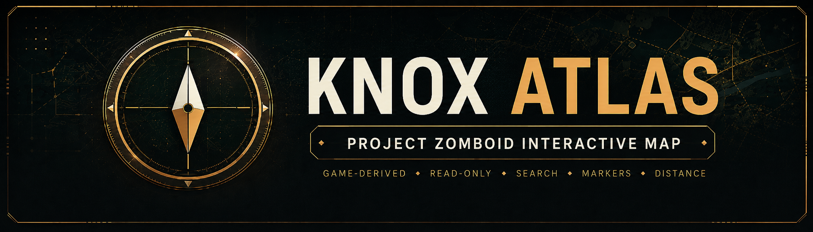
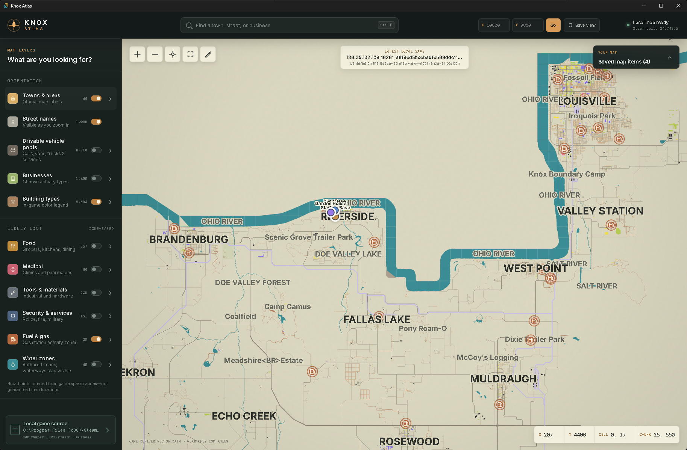

<p align="center">
  
</p>

# 🗺️ Knox Atlas — Project Zomboid Interactive Map

Knox Atlas is a local companion atlas built from the map data in your Project Zomboid installation.
It helps you quickly find where useful places and supplies might be, and navigate to them.
It does not edit the game's installation or
save files.

> **Development branch notice:** this checkout is the **0.2.0 core evolution**, still in progress.
> The published **0.1.1** app and its screenshots have features that are not yet ported here.
> See [current progress](docs/progress.md) for what actually works and what remains.

## ⬇️ Using the released app

Download the compiled Windows app from
[GitHub Releases](https://github.com/TheMysticTurtle/Knox-Atlas/releases).

- **Installer:** run the setup EXE and use the normal Windows shortcut.
- **Portable ZIP:** extract it, keep the included files together, and run `Knox-Atlas.exe`.
  It requires Microsoft WebView2; use the
  [official Microsoft download](https://developer.microsoft.com/en-us/microsoft-edge/webview2/).

Released 0.1.1 includes search, coordinate tools, expandable zone filters, named colored markers,
multi-point measurements/saved paths, a saved map view, and a game-installation folder picker.
Its loot/vehicle zones are possibilities, not confirmed inventory or vehicles.

Released-app guidance: [portable and data backup](legacy/docs/portable.md),
[Vortex tool setup](legacy/docs/vortex.md), and [distribution/source-build notes](legacy/docs/distribution.md).
These guides describe the 0.1.x layout; do not use their build commands against this development
branch. To build the released app, use the matching release's source archive.

Markers, paths, and settings in the released installer/portable persist per Windows account,
not beside the portable EXE. Development browser storage may be separate. The new branch preserves
the application identifier, but **saved-item readers and upgrade compatibility are not finished**.
Keep existing data backed up; do not clear the app profile to try this branch.

### 🛡️ Windows notice

Current releases are unsigned, so SmartScreen may show an unfamiliar-publisher warning.
An antivirus malware detection is a separate matter and should be investigated, not dismissed
because an app is unsigned. The source and build workflow are available for inspection.

## ✨ What works in this branch

- Vector overview with terrain, waterways, roads, railways, and building footprints.
- Pan/zoom and town, area, street, and landmark labels.
- Room-derived points of interest from the installed `.lotheader` files.
- Expandable, multi-tag likely-loot filters, including garages and sheds.
- Clickable room cards with coordinates, floor information, and possible items inferred from
  installed loot definitions.
- **Satellite view** from the game's own terrain imagery, with the same labels and dots on top.
- Coordinate tools: jump to an X/Y, a live coordinate readout, and copy X/Y from a card.
- **Your map:** click anywhere to save a named, colored place, copy its X/Y, or measure a distance
  and save it as a path; save your view so the map opens there. Uses the same storage format as
  0.1.1 so existing saved items carry over (packaged upgrade still to be verified).
- **🧭 Navigate:** click the map to add stops in order and get a route along the streets, with its
  distance and the streets to take; save your favourite routes and reopen them to edit.

Room types are not unique business names; static loot is not live inventory. Current filtering
hides unmatched dots, and POIs from different floors are still mixed.

Search, game-path selection, and vehicle overlays still need their active-branch port. See the
[roadmap](docs/roadmap.md).

## 🧭 Where it is heading

Knox Atlas stays **simple by default** and **helpful, not a cheat**: it helps you plan where to go,
without revealing exactly where everything is.

**Next:** routing on side roads (dirt backroads as an opt-in), and
dragging a route to reshape it. Then **search** for a store type, a category, or a specific item to see every place it's
likely found. After that, polish: quick place-finding toggles, focus highlighting, better loot
cards, and floor outlines.

**Optional extras later**, always opt-in and never cluttering the default: live own-player
coordinates via a small companion mod, last-saved position from your own saves, and a shareable
view for friends. Full design: [map views and navigation](docs/map-views-navigation.md).

## 🛠️ Working on the current source

The frontend is in `web/`; Rust is a root Cargo workspace. Browser development from repository
root, with Rust, Node/npm, and a local Project Zomboid installation:

```powershell
npm --prefix web ci
cargo run -p knox-atlas-core --example dump_snapshot
npm --prefix web run dev
```

Open `http://localhost:1420`. The Rust example writes the three local preview JSON files itself;
do not redirect its status output into a JSON file. Generated map data stays out of the repository.

Desktop build hooks and GitHub packaging still need migration to this layout. A preview is not
evidence that the installer pipeline works. See the [development guide](docs/development.md) for
checks, build blockers, storage compatibility, and handoff notes. Release packaging remains a
manual action; a documentation push does not start a release build.

## 📚 Documentation

- [Progress and worklog](docs/progress.md) — audited state, verification, next task, historical notes.
- [Roadmap](docs/roadmap.md) — product principles, next steps in order, optional extras.
- [Architecture](docs/architecture.md) — implemented boundaries and planned extensions.
- [Map data](docs/map-data.md) — sources, coordinates, loot/save limitations.
- [Map views and navigation](docs/map-views-navigation.md) — satellite imagery, floor composition,
  road path plotting, player-position findings.
- [Room taxonomy](docs/taxonomy.md) and [header format](docs/lotheader-format.md) — classification,
  known gaps, parser behavior.
- [Development](docs/development.md) — current commands and future-session checklist.
- [Changelog](CHANGELOG.md) — release history and unreleased development work.
- [Historical 0.1.x docs](legacy/docs/roadmap.md) — prototype notes, not current implementation status.

## 📷 Released-app example

The following image shows **0.1.1**, not the current development UI:

<p align="center">
  
</p>

## 🤝 Feedback, source, and credits

Reproducible map findings and code review are welcome. For a map mismatch, include the game build,
approximate X/Y/Z, selected map/source, and any relevant map mods.

Knox Atlas is source-available under [PolyForm Strict 1.0.0](LICENSE); see the license for permitted
use. Please open an issue for collaboration or reuse questions.

Knox Atlas is an unofficial community tool. Project Zomboid and its game data belong to
The Indie Stone. This repository does not redistribute game map assets; users supply their own
installation. The application uses Rust, Tauri, React, and TypeScript, along with the dependencies listed in the
source manifests. Their respective license notices continue to apply.
